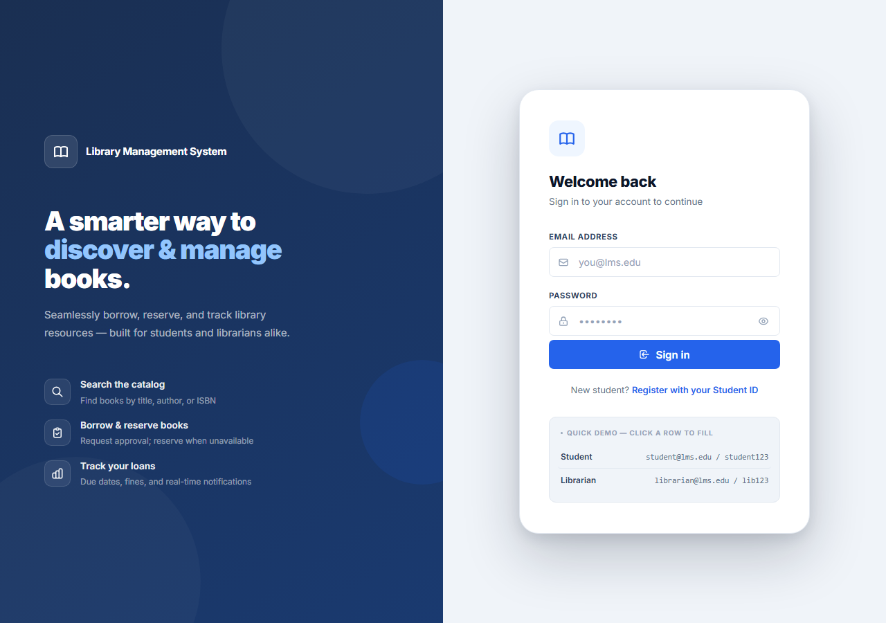
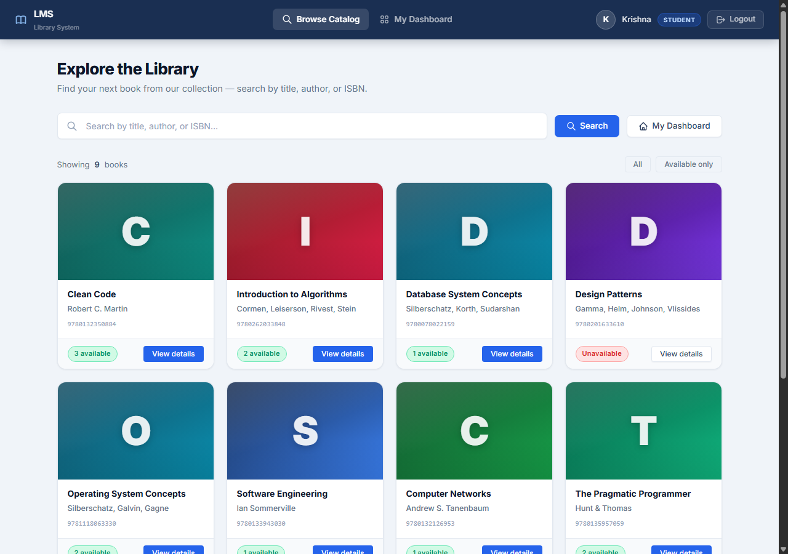
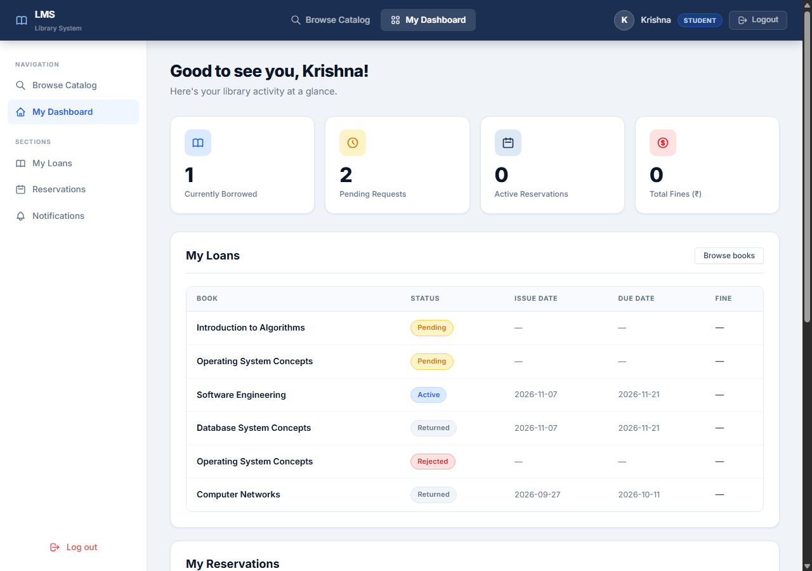
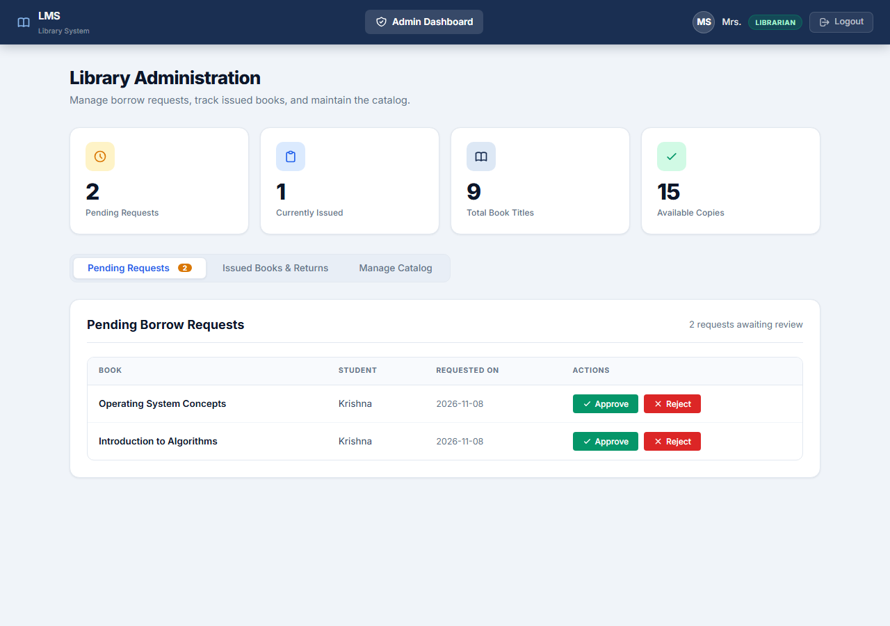

# Library Management System (LMS)

[](https://nodejs.org/)
[](https://expressjs.com/)
[](https://sqlite.org/)
[](https://github.com/dcodeIO/bcrypt.js)

A full-stack, web-based Library Management System developed to digitize and streamline institutional library operations. The system features end-to-end workflows including controlled student self-registration with university ID verification, librarian authorization, book catalog management, borrowing request lifecycles, automated due date and fine calculations, book reservations, and student notification queues.

---

## Table of Contents

- [Overview](#overview)
- [Key Features](#key-features)
- [Technology Stack](#technology-stack)
- [System Requirements](#system-requirements)
- [Installation & Setup](#installation--setup)
- [Running the Application](#running-the-application)
- [Demo Credentials](#demo-credentials)
- [Database & Zero-Config Initialization](#database--zero-config-initialization)
- [Project Directory Structure](#project-directory-structure)
- [Screenshots](#screenshots)
- [API Overview](#api-overview)
- [Future Enhancements](#future-enhancements)
- [Academic Credits](#academic-credits)
- [License](#license)

---

## Overview

Traditional library record-keeping is prone to manual tracking delays, unverified registrations, and fragmented catalog records. This application provides a lightweight yet robust digital solution designed for academic departments. 

Using an embedded SQLite engine (`sql.js`), the application runs without needing separate database server installations (such as PostgreSQL or MySQL) while ensuring full ACID-compliant relational data management.

---

## Key Features

### 1. Controlled Student Self-Registration & Verification
- **University Student ID Whitelist**: Librarians pre-authorize valid student IDs into the system with optional student name/department notes.
- **Self-Registration Form**: Students register using their Full Name, University Student ID, Email, and Password.
- **Server-Side Validation**: Ensures matching passwords, minimum length requirements, valid institutional email formats, and verified unused student IDs.
- **Librarian Approval Workflow**: New student accounts are created in a `pending` status. Librarians review, approve, or reject registrations from the librarian dashboard before library access is granted.

### 2. Role-Based Access Control (RBAC) & Security
- Separate workflows and navigation states for **Students** and **Librarians**.
- Passwords securely hashed using `bcryptjs` (salt rounds = 8).
- HttpOnly, SameSite session cookies protecting endpoints from unauthorized access.
- Parameterized SQL queries preventing SQL injection vulnerabilities.

### 3. Book Catalog & Real-Time Availability
- Search book records across titles, authors, and ISBN numbers with real-time feedback.
- Availability counters showing total copies and currently available shelf copies.
- Dynamic action triggers: **Request to Borrow** (when copies are available) or **Reserve** (when all copies are checked out).

### 4. Borrowing & Return Lifecycle
- **Borrow Requests**: Students submit borrowing requests; librarians review and approve with automatic due date computation (14-day loan window).
- **Return Tracking**: Librarians process book returns with instant fine computation (₹5/day for overdue returns).
- **Inventory Synchronization**: Shelf counts automatically increment/decrement on checkout and return.

### 5. Reservation Queue
- Students can place holds on books currently with zero available shelf copies.
- Queued reservations are tracked with student ID and timestamp.

### 6. Dashboards & Notifications
- **Student Dashboard**: Overview of active loans, due dates, past return history, active book reservations, and system notification alerts.
- **Librarian Dashboard**: Unified management interface featuring tabbed views for:
  1. *Student Registration Requests* (Approve/Reject pending students)
  2. *Authorized Student IDs* (Manage pre-approved ID whitelist)
  3. *Pending Borrow Requests* (Approve/Reject book checkout requests)
  4. *Issued Books & Returns* (Process returns and calculate fines)
  5. *Catalog Management* (Add new book titles, ISBNs, and copy counts)

---

## Technology Stack

| Layer | Technology | Description |
|---|---|---|
| **Frontend** | HTML5, CSS3, Vanilla JavaScript (ES6+) | Clean, responsive UI with zero heavy frontend framework overhead |
| **Backend** | Node.js, Express.js | Fast, minimalist RESTful API and static file web server |
| **Database** | SQLite via `sql.js` (WebAssembly) | Embedded relational database requiring zero external server configuration |
| **Authentication** | `bcryptjs`, Secure Cookies | Industry-standard password hashing and stateful session management |
| **Tooling** | Git, npm | Version control and package management |

---

## System Requirements

- **Node.js**: Version `18.0.0` or higher (tested on Node.js v20+)
- **npm**: Version `9.0.0` or higher
- **Web Browser**: Any modern browser (Google Chrome, Mozilla Firefox, Microsoft Edge, Safari)
- **OS**: Windows, macOS, or Linux

---

## Installation & Setup

1. **Clone the repository**:
   ```bash
   git clone https://github.com/<your-username>/library-management-system.git
   cd library-management-system
   ```

2. **Install dependencies**:
   ```bash
   npm install
   ```

3. **Configure environment variables (Optional)**:
   Copy the example environment file if you wish to customize the server port:
   ```bash
   cp .env.example .env
   ```
   *(Default port is `3000`)*

---

## Running the Application

1. **Start the server**:
   ```bash
   npm start
   ```

2. **Access the web interface**:
   Open your browser and navigate to:
   ```
   http://localhost:3000
   ```

---

## Demo Credentials

The application initializes with pre-configured demo accounts for testing and evaluation:

| Role | Name | Email | Password | Status | Notes |
|---|---|---|---|---|---|
| **Librarian** | Mrs. Sunitha | `librarian@lms.edu` | `lib123` | Active | Full administrative and approval privileges |
| **Student (Primary)** | Krishna | `student@lms.edu` | `student123` | Active | Demo student account with borrowing access |
| **Student (Secondary)**| Karan Mehta | `student2@lms.edu` | `student123` | Active | Demo student with an existing book reservation |

> **Note**: For testing the self-registration workflow, log in as the Librarian and add an authorized student ID (e.g. `20241CSE0100`) under the **Authorized Student IDs** tab, then register a new student account using that ID.

---

## Database & Zero-Config Initialization

- **Automatic Initialization**: When the server starts for the first time, `db.js` detects whether `data/library.db` exists. If not found, it automatically creates the relational schema (tables, foreign keys, constraints, and indexes) and populates safe, fictional demo seed data.
- **Embedded Storage**: The SQLite database file resides at `data/library.db` during local execution.
- **Reset to Clean State**: To completely reset the database back to clean demo data at any time, stop the server, delete `data/library.db`, and restart with `npm start`.

---

## Project Directory Structure

```
library-management-system/
├── data/
│   └── .gitkeep              # Preserves directory structure; local .db files are gitignored
├── public/
│   ├── book.html             # Screen: Book details, borrow request & reservation actions
│   ├── catalog.html          # Screen: Searchable book catalog with filters
│   ├── common.js             # Shared frontend utilities, auth guards, and navbar logic
│   ├── dashboard.html        # Screen: Student dashboard (loans, reservations, alerts)
│   ├── index.html            # Screen: User login portal
│   ├── librarian.html        # Screen: Librarian admin panel (approvals, catalog, returns)
│   ├── register.html         # Screen: Student self-registration page
│   └── style.css             # Unified application styling, layout, and component CSS
├── .env.example              # Template for environment configuration
├── .gitignore                # Excludes node_modules, local SQLite files, logs, and OS files
├── db.js                     # SQLite initialization, schema migrations, and query helpers
├── package.json              # Project metadata, scripts, and dependencies
├── package-lock.json         # Pinned dependency tree
├── README.md                 # Project documentation and guide
└── server.js                 # Express server, authentication middleware, and REST API routes
```

---

## Screenshots

*(Place application screenshots in a `docs/screenshots/` directory or link your hosted images below)*

| Login Portal | Book Catalog |
|:---:|:---:|
|  |  |

| Student Dashboard | Librarian Admin Panel |
|:---:|:---:|
|  |  |

---

## API Overview

| Method | Endpoint | Access | Description |
|---|---|---|---|
| `POST` | `/api/login` | Public | Authenticates user and sets session cookie |
| `POST` | `/api/logout` | Authenticated | Clears user session |
| `GET` | `/api/auth/me` | Authenticated | Fetches current user profile and role |
| `POST` | `/api/register` | Public | Submits student registration request |
| `GET` | `/api/books` | Public | Lists all books (supports `?q=` search query) |
| `GET` | `/api/books/:id` | Public | Retrieves specific book details |
| `POST` | `/api/borrow` | Active Student | Submits a borrow request for a book |
| `POST` | `/api/reserve` | Active Student | Places a reservation on an unavailable book |
| `GET` | `/api/student/:id/dashboard` | Active Student | Returns active loans, history, and notifications |
| `GET` | `/api/librarian/requests` | Librarian | Lists pending borrow requests |
| `POST` | `/api/librarian/approve/:id` | Librarian | Approves a borrow request (sets 14-day due date) |
| `POST` | `/api/librarian/reject/:id` | Librarian | Rejects a borrow request |
| `GET` | `/api/librarian/issued` | Librarian | Lists all currently issued books |
| `POST` | `/api/librarian/return/:id` | Librarian | Processes book return and calculates fine |
| `GET` | `/api/librarian/catalog` | Librarian | Fetches books with borrowing statistics |
| `POST` | `/api/librarian/catalog` | Librarian | Adds a new book title to the catalog |
| `GET` | `/api/librarian/authorized-ids`| Librarian | Lists authorized student ID entries |
| `POST` | `/api/librarian/authorized-ids`| Librarian | Pre-authorizes a new student ID |
| `DELETE`| `/api/librarian/authorized-ids/:id` | Librarian | Deletes an authorized student ID record |
| `GET` | `/api/librarian/registrations` | Librarian | Lists pending student registrations |
| `POST` | `/api/librarian/registrations/:id/approve` | Librarian | Approves pending student registration |
| `POST` | `/api/librarian/registrations/:id/reject` | Librarian | Rejects pending student registration |

---

## Future Enhancements

- [ ] Automated email alerts for pending returns and overdue fines via SMTP / Nodemailer.
- [ ] Automated reservation fulfillment: auto-assign returned books to the first student in the waiting queue.
- [ ] Exportable analytics reports (CSV/PDF) for library inventory and overdue fines.
- [ ] Barcode / QR Code scanning integration for rapid physical checkouts.
- [ ] Multi-copy ISBN tracking with individual book copy accession numbers.

---

## Academic Credits

Developed as a mini-project for **CSE 2271: Database & Software Systems Development**.

- **Lead Developer**: Krishna
- **Platform**: Antigravity Full-Stack Development Environment

---

## License

This project is licensed under the [MIT License](LICENSE).
